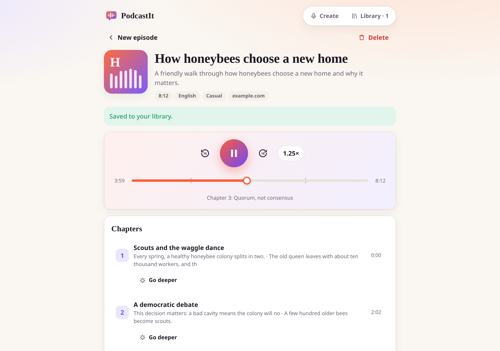

# PodcastIt

Turn any article, PDF or text into a two-host podcast episode — with chapters, a synced transcript, "Go deeper" sequels and a personal library. An app for **Anna AI OS**.



## What it does

1. **Give it something to read** — paste a link, drop a PDF / TXT / Markdown / HTML / subtitle file, or paste text.
2. **Pick the show** — 3, 8 or 15 minutes; Casual, Deep-dive or Kids-friendly; English, Français, العربية or Español; two host voices.
3. **PodcastIt produces it**
   - long sources (> 24k characters) are condensed into notes first (up to 16 sections, in parallel);
   - the AI plans the chapters, then writes a natural dialogue for each chapter — Host A asks what a listener would ask, Host B explains from the source;
   - every turn is voiced with Anna TTS in two distinct voices, with live progress ("Recording the voices — 37 / 68 segments"). You can start listening while the rest is recorded.
4. **Listen** — one player for the whole episode: play/pause, ±15 s, speed 0.75–2×, chapter ticks and jumps, tap any transcript line to jump there, follow-along highlight, lock-screen controls.
5. **Go deeper** on any chapter — a 3- or 8-minute follow-up episode that doesn't repeat what was said.
6. **Library** — episodes are saved automatically (transcript in Anna storage, audio as stored files) and can be replayed, re-voiced or deleted.

### Reliability

| Situation | What happens |
|---|---|
| Unfetchable URL (404, paywall, private IP, timeout) | Clear message, suggestion to paste the text |
| Scanned / locked / huge PDF | Specific message |
| Very long input | Condensed into notes first; books are sampled evenly |
| Outline or script the parser can't read | Retried automatically |
| TTS hiccup / rate limit | Segment retried with backoff (3 attempts) |
| Voice not valid for the model | Falls back to the default voice |
| Segment over the model's character cap | Split and re-joined |
| Content rejected for one segment | Skipped, "Retry those clips" offered |
| Out of credits / no TTS model | Stops, keeps the script, "Retry recording" |
| Audio upload fails | Transcript saved, "Voice it" later |
| Stored audio URL expired | Re-minted automatically |

## Architecture

Front-end only — no Executa, no server. All AI and storage go through the Anna Host API from the sandboxed iframe, billed to the user's Anna credits:

| Need | Host API |
|---|---|
| Read a web page | `web.fetch` |
| Notes, outline, dialogue | `llm.complete` (stateless, `thinking: false`) |
| Pick TTS model + voices | `llm.catalog({serviceType: "tts"})` |
| Voices | `audio.speak` (`format: mp3`, `delivery: inline`) |
| Library metadata | `storage.get/set/delete` (per-user APS) |
| Library audio | `upload.inline` + `upload.confirm` (durable `r2_key`) |
| Window title | `window.set_title` |

```
src/host/       HostApi interface, Anna SDK adapter, local mock host
src/lib/        pipeline, prompts + parsers, segment planning, audio bytes, library, errors
src/ui/         Preact screens + playlist player
tests/          vitest (70 tests)
scripts/        Playwright browser walkthrough
manifest.json   Anna app manifest (schema 4)
app.json        store listing metadata for the anna-app CLI
```

Notes: the bundle loads the SDK from `/static/anna-apps/_sdk/latest/index.js`; the CSP adds only `media-src https:` (to play the stored audio's presigned URLs). The window declares `form_factors: ["desktop", "mobile"]` and follows the mobile checklist (no own viewport meta, safe-area insets, 44 px targets, no hover-only actions). The app follows Anna's light/dark theme.

## Develop

```bash
npm install
npm run dev            # http://localhost:5199 — runs against the built-in mock host (no account, no credits)
npm test               # vitest
npm run build          # type-check + production bundle in ./bundle (mock excluded)
npm run validate       # anna-app validate --strict
npm run check:browser  # Playwright walkthrough (needs `npm run dev` running)
```

Mock flags (dev only): `?mockFast=1` (no latency), `?mockFail=tts` (flaky TTS), `?mockFail=quota` (out of credits), `?theme=dark`, `?payloadUrl=<url>` (simulates Anna chat opening the app with a link).

Inside Anna, the assistant can open PodcastIt with a payload such as `{"url": "https://…", "lengthMin": 8, "tone": "deep-dive", "language": "fr"}`; the form is pre-filled and the user starts it.

Publishing steps: see [OWNER_STEPS.md](OWNER_STEPS.md).

## License

MIT — see [LICENSE](LICENSE). Privacy: [PRIVACY.md](PRIVACY.md).
