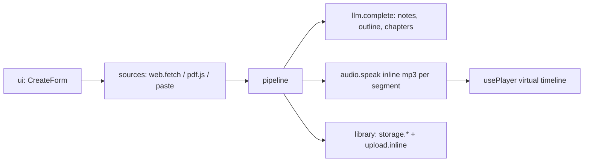

---
tags:
  - memory
  - architecture
  - podcastit
last_updated: 2026-11-24
---

# Architecture

Static SPA in a sandboxed Anna iframe. `connectHost()` loads the SDK from `/static/anna-apps/_sdk/latest/index.js` (or the mock in `--mode mock`). The UI calls [[pipeline]], which calls the host.

- Entry: `src/main.tsx` → `src/ui/App.tsx` (Studio state machine)
- Data: APS KV keys `library/index`, `episodes/<id>`, `sources/<id>`; audio parts via upload r2_key
- External: none besides the Anna host (CSP media-src https: for presigned audio)

Back to [[index]]
